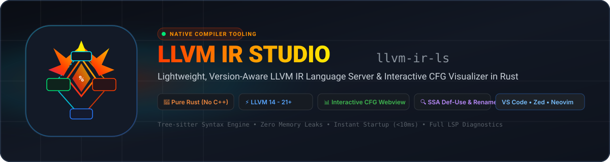

<p align="center">
  <picture>
    <source media="(prefers-color-scheme: dark)" srcset="assets/banner.svg">
    
  </picture>
</p>

<p align="center">
  <a href="https://github.com/SohamTilekar/llvm-ir-studio/releases"></a>
  <a href="https://marketplace.visualstudio.com/items?itemName=SohamTilekar.llvm-ir-studio"></a>
  <a href="https://open-vsx.org/extension/sohamtilekar/llvm-ir-advance"></a>
  <a href="https://github.com/SohamTilekar/llvm-ir-studio/blob/main/LICENSE"></a>
  
  
</p>

# LLVM IR Studio (`llvm-ir-ls`)

A fast, version-aware **Language Server Protocol (LSP)** implementation and interactive **Control Flow Graph (CFG) visualizer** for LLVM Intermediate Representation (`.ll`).

Implemented in pure Rust with zero C++ `libLLVM` dependencies, `llvm-ir-ls` provides sub-millisecond startup, incremental parsing, and syntax diagnostics across LLVM 14 to 21+.

---

## ⚡ Quickstart

Get up and running with `llvm-ir-ls` in two simple steps:

### Step 1: Install the Language Server Binary

Install the pre-compiled binary for Linux or macOS directly to `~/.local/bin`:

```bash
curl -fsSL https://raw.githubusercontent.com/SohamTilekar/llvm-ir-studio/main/install.sh | bash
```

<details>
<summary>Other Installation Methods (Windows, Cargo, Manual)</summary>

- **Windows (PowerShell)**:
  ```powershell
  irm https://raw.githubusercontent.com/SohamTilekar/llvm-ir-studio/main/install.ps1 | iex
  ```
- **Via Cargo (Rust)**:
  ```bash
  cargo install --git https://github.com/SohamTilekar/llvm-ir-studio.git llvm-ir-ls
  ```
- **Pre-built Archives**: Download direct binaries for Linux, macOS, or Windows from [GitHub Releases](https://github.com/SohamTilekar/llvm-ir-studio/releases).
</details>

Verify the binary is available in your `$PATH`:
```bash
llvm-ir-ls --version
```

### Step 2: Auto-Configure Your Editor

Run the automated setup script to detect your installed editors and configure them automatically:

```bash
curl -fsSL https://raw.githubusercontent.com/SohamTilekar/llvm-ir-studio/main/setup-editor.sh | bash
```

Alternatively, follow the quick manual configuration steps for your editor below.

---

## 🔌 Editor Support

`llvm-ir-ls` conforms to the Language Server Protocol and integrates with any LSP-capable editor.

> 📌 Upstream registry publication status across all editors is tracked in [`DISTRIBUTION_TRACKER.md`](DISTRIBUTION_TRACKER.md).

| Editor | Support Type | Setup Guide | Configuration / Source |
| :--- | :--- | :--- | :--- |
| **VS Code & Cursor** | Full Extension | [Installation Guide](#vs-code-cursor--vscodium) | [`editors/vscode`](editors/vscode) |
| **Neovim / Vim** | Native `vim.lsp.start` / 0.11+ config | [Installation Guide](#neovim) | [`editors/neovim`](editors/neovim) |
| **Helix** | Native `languages.toml` | [Installation Guide](#helix) | [`editors/helix`](editors/helix) |
| **Zed** | Extension (`.wasm`) | [Installation Guide](#zed) | [`editors/zed`](editors/zed) |
| **Sublime Text** | Sublime `LSP` package | [Installation Guide](#sublime-text) | [`editors/sublime`](editors/sublime) |
| **GNU Emacs** | `eglot` (built-in) & `lsp-mode` | [Installation Guide](#gnu-emacs) | [`editors/emacs`](editors/emacs) |
| **JetBrains (CLion / Fleet)** | LSP4IJ plugin / Fleet settings | [Installation Guide](#jetbrains-ides-clion--fleet) | [`editors/jetbrains`](editors/jetbrains) |
| **Kate** | Built-in LSP Client | [Installation Guide](#kate-kde) | [`editors/kate`](editors/kate) |
| **Web Browser** | In-Browser Live Studio & CFG | [Launch Guide](#in-browser-playground) | [`web`](web) |

---

### VS Code, Cursor & VSCodium

The extension provides full LSP diagnostics, hover definitions, SSA rename, and an interactive side-panel CFG visualizer.

#### Installation

- **VS Code**: Install **LLVM IR Studio** from the [Visual Studio Marketplace](https://marketplace.visualstudio.com/items?itemName=SohamTilekar.llvm-ir-studio) or run:
  ```bash
  code --install-extension sohamtilekar.llvm-ir-studio
  ```
- **Cursor**:
  ```bash
  cursor --install-extension sohamtilekar.llvm-ir-studio
  ```
- **VSCodium / Open VSX**: Install **LLVM IR Advance** from [Open VSX](https://open-vsx.org/extension/sohamtilekar/llvm-ir-advance) or run:
  ```bash
  codium --install-extension sohamtilekar.llvm-ir-advance
  ```
- **Manual VSIX**: Download the latest `.vsix` package from [GitHub Releases](https://github.com/SohamTilekar/llvm-ir-studio/releases) and install via `Extensions: Install from VSIX...`.

#### Visualizing CFGs
Open any `.ll` file and press `Ctrl+Shift+P` (or `Cmd+Shift+P` on macOS) -> run `LLVM IR: Show Function CFG`.

---

### Neovim

Neovim supports `llvm-ir-ls` out-of-the-box with **zero external plugins required**.

#### Quick Setup (Automated)

```bash
./setup-editor.sh --neovim
```

#### Manual Setup

##### Option A: Native Neovim (v0.10+ / v0.11+) — Recommended (Zero Plugins)

1. Ensure `.ll` filetype detection is registered in `~/.config/nvim/ftdetect/llvm.lua`:
   ```lua
   vim.filetype.add({ extension = { ll = 'llvm' } })
   ```

2. Copy [`editors/neovim/ftplugin/llvm.lua`](editors/neovim/ftplugin/llvm.lua) to `~/.config/nvim/ftplugin/llvm.lua`:
   ```bash
   mkdir -p ~/.config/nvim/ftplugin
   cp editors/neovim/ftplugin/llvm.lua ~/.config/nvim/ftplugin/llvm.lua
   ```

When opening any `.ll` file, Neovim automatically attaches `llvm-ir-ls` and sets up standard navigation keymaps:
- `gd` — Go to definition (SSA register or `@global` symbol)
- `gr` — Find all SSA references
- `K` — Hover for LLVM LangRef instruction syntax
- `<leader>rn` — Rename SSA register or label within function scope
- `:LLVMCheck` — Validate current IR and show diagnostics
- `:LLVMCFG` — Generate and view interactive HTML Control Flow Graph in default browser

##### Option B: Neovim 0.11+ Native File-Based LSP Config

Copy [`editors/neovim/lsp/llvm_ir_ls.lua`](editors/neovim/lsp/llvm_ir_ls.lua) to `~/.config/nvim/lsp/llvm_ir_ls.lua`:
```bash
mkdir -p ~/.config/nvim/lsp
cp editors/neovim/lsp/llvm_ir_ls.lua ~/.config/nvim/lsp/llvm_ir_ls.lua
```
Then add to your `init.lua`:
```lua
vim.lsp.enable('llvm_ir_ls')
```

##### Option C: Legacy `nvim-lspconfig` (Neovim 0.9 / 0.10)

Add to your `init.lua`:
```lua
local lspconfig = require('lspconfig')
local configs = require('lspconfig.configs')

if not configs.llvm_ir_ls then
  configs.llvm_ir_ls = {
    default_config = {
      cmd = { 'llvm-ir-ls', 'lsp' },
      filetypes = { 'llvm' },
      root_dir = lspconfig.util.root_pattern('.llvm-ir-ls.toml', '.git', '.'),
      settings = {},
    },
  }
end

lspconfig.llvm_ir_ls.setup({})
```

> **Note on Mason:** The language server binary is not distributed via the Mason registry. Please install the binary using `install.sh`, Cargo, or GitHub Releases as described in [Step 1](#step-1-install-the-language-server-binary).

---

### Helix

Add the language and server definitions to `~/.config/helix/languages.toml` (or run `./setup-editor.sh --helix`):

```toml
[[language]]
name = "llvm"
scope = "source.llvm"
injection-regex = "llvm"
file-types = ["ll"]
roots = [".llvm-ir-ls.toml", ".git"]
language-servers = ["llvm-ir-ls"]
indent = { tab-width = 2, unit = "  " }

[language-server.llvm-ir-ls]
command = "llvm-ir-ls"
args = ["lsp"]
```

Verify your setup:
```bash
hx --health llvm
```

---

### Zed

The Zed extension source is located in [`editors/zed`](editors/zed).

#### Installation
1. Press `Ctrl+Shift+P` (or `Cmd+Shift+P` on macOS) in Zed.
2. Select **`zed: install dev extension`**.
3. Choose the [`editors/zed`](editors/zed) directory.

---

### Sublime Text

1. Install the `LSP` package from Package Control.
2. Open **Preferences** -> **Package Settings** -> **LSP** -> **Settings** (`LSP.sublime-settings`) and add:

```json
{
  "clients": {
    "llvm-ir-ls": {
      "enabled": true,
      "command": ["llvm-ir-ls", "lsp"],
      "selector": "source.llvm",
      "schemes": ["file"]
    }
  }
}
```

---

### GNU Emacs

See [`editors/emacs`](editors/emacs) for details and helper module [`llvm-ir-ls.el`](editors/emacs/llvm-ir-ls.el).

#### Eglot (Emacs 29+ built-in)
```elisp
(require 'eglot)
(add-to-list 'auto-mode-alist '("\\.ll\\'" . llvm-mode))
(add-to-list 'eglot-server-programs '(llvm-mode . ("llvm-ir-ls" "lsp")))
(add-hook 'llvm-mode-hook #'eglot-ensure)
```

#### `lsp-mode`
```elisp
(lsp-register-client
 (make-lsp-client :new-connection (lsp-stdio-connection '("llvm-ir-ls" "lsp"))
                  :major-modes '(llvm-mode)
                  :server-id 'llvm-ir-ls))
(add-hook 'llvm-mode-hook #'lsp-deferred)
```

---

### JetBrains IDEs (CLion & Fleet)

- **CLion / RustRover / IntelliJ**: Install the official **LSP4IJ** plugin. Go to **Settings** -> **Languages & Frameworks** -> **Language Servers** -> add a new server with executable `llvm-ir-ls`, argument `lsp`, and file pattern `*.ll`.
- **JetBrains Fleet**: Add to `.fleet/settings.json`:
  ```json
  {
    "lsp": {
      "llvm-ir-ls": {
        "command": ["llvm-ir-ls", "lsp"],
        "filePatterns": ["*.ll"]
      }
    }
  }
  ```

---

### Kate (KDE)

Enable the built-in **LSP Client** plugin. Open **Settings** -> **Configure Kate...** -> **LSP Client** -> **User Server Settings**, and paste:

```json
{
  "servers": {
    "llvm": {
      "command": ["llvm-ir-ls", "lsp"],
      "rootIndicationFileNames": [".llvm-ir-ls.toml", ".git"],
      "url": "https://github.com/SohamTilekar/llvm-ir-studio",
      "highlightingModeRegex": "^LLVM.*$"
    }
  }
}
```

---

### In-Browser Playground

Launch the zero-dependency local web studio to inspect and edit LLVM IR files with real-time CFG rendering and diagnostics:

```bash
# Launch empty playground on http://127.0.0.1:3000
llvm-ir-ls playground

# Pre-load an existing file on custom port
llvm-ir-ls playground example.ll --port 8080
```

---

## 🛠 Features & Capabilities

- **Zero C++ Dependencies**: Pure Rust architecture with instantaneous startup and low memory overhead.
- **LLVM Version Awareness**: Validates syntax rules across LLVM 14 through 21+ (opaque pointers `ptr` vs typed pointers `i32*`, explicit `getelementptr` element types, attribute syntax migrations).
- **Error-Tolerant Tree-sitter Parsing**: Provides uninterrupted syntax trees and diagnostics even on incomplete or malformed IR.
- **SSA Def-Use Analysis**: Instant Go-to-Definition, Find All References, and function-scoped register/block renaming.
- **Interactive Control Flow Graph (CFG)**: Generates visual CFG diagrams in interactive HTML, Mermaid, and Graphviz DOT formats.
- **Standardized Diagnostics**: Deterministic error codes (`LLVM-SYNTAX-001`, `LLVM-VER-001`, `LLVM-SSA-001`, `LLVM-CFG-001`) with precise source ranges.

---

## 💻 CLI Usage

The `llvm-ir-ls` binary functions as both a language server and a command-line tool.

### 1. IR Syntax & Compatibility Checking

Human-readable output:
```bash
llvm-ir-ls check input.ll --version 18
```

JSON output for scripts and CI pipelines:
```bash
llvm-ir-ls check input.ll --format json
```

### 2. Control Flow Graph Export

Generate interactive standalone HTML:
```bash
llvm-ir-ls cfg input.ll --fn @main --format html -o cfg.html
```

Generate Mermaid diagram:
```bash
llvm-ir-ls cfg input.ll --fn @main --format mermaid
```

Generate Graphviz DOT:
```bash
llvm-ir-ls cfg input.ll --fn @main --format dot -o cfg.dot
```

### 3. Launch Language Server (LSP Mode)

```bash
llvm-ir-ls lsp
```

---

## 🏗 Building from Source

Prerequisites: Rust stable toolchain (`cargo`).

```bash
git clone https://github.com/SohamTilekar/llvm-ir-studio.git
cd llvm-ir-studio

# Build optimized binary
cargo build --release --bin llvm-ir-ls

# Install to ~/.cargo/bin
cargo install --path crates/llvm-ir-ls
```

Run test suite:
```bash
cargo test
```

---

## 📄 License

This project is licensed under the [MIT License](LICENSE).
